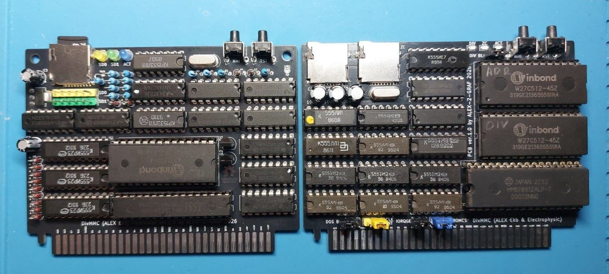
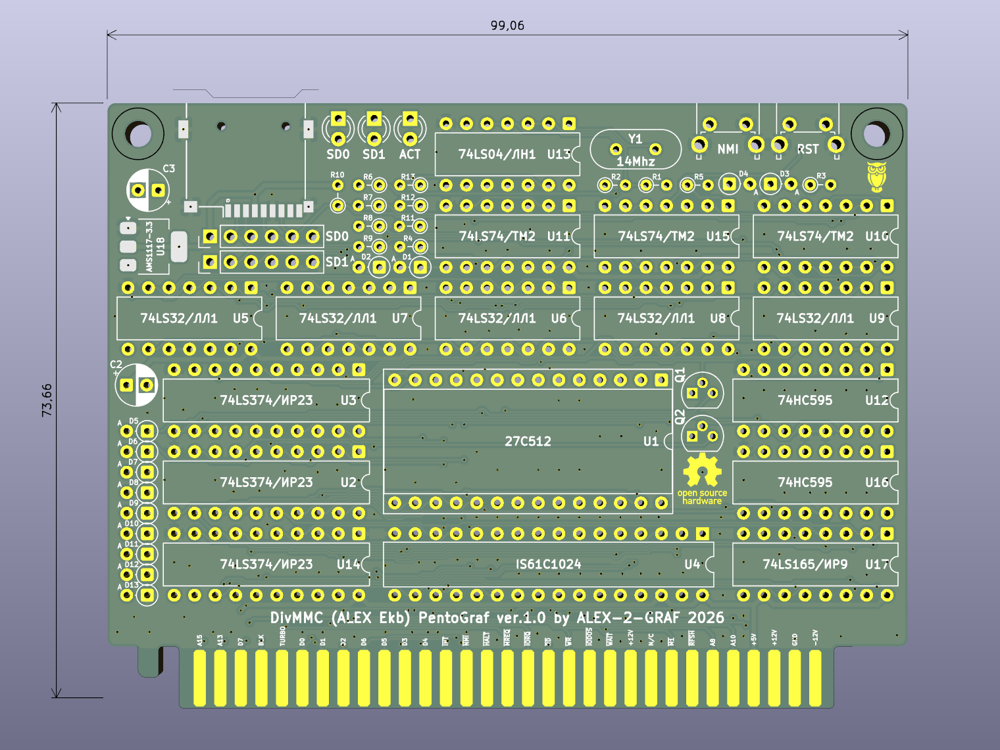
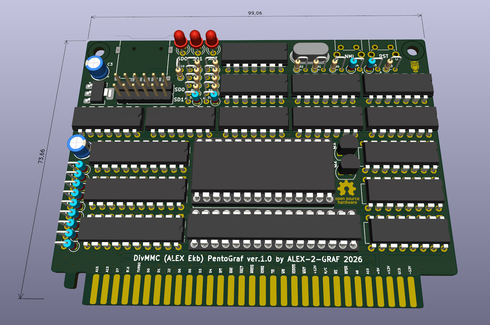
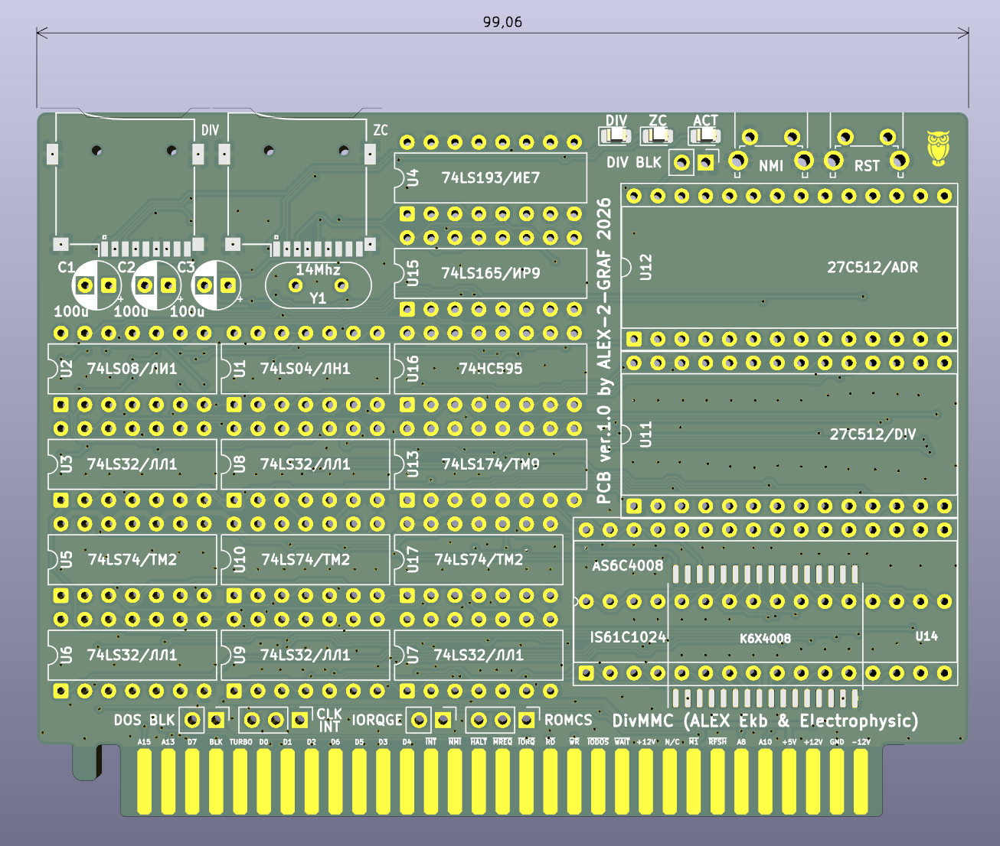
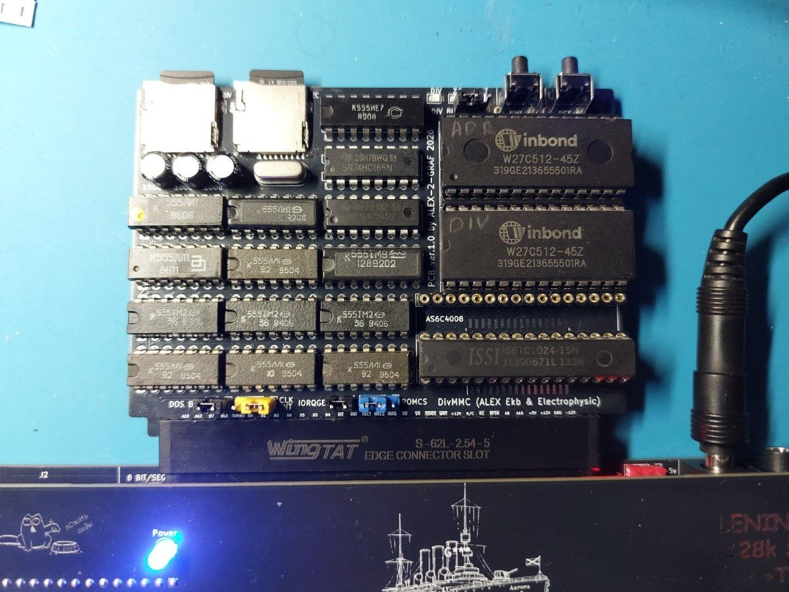

# PentoGraf-DivMMC-x2

DivMMC (Aurora clone) \& DivMMC + Z-Controller with Dual ROM for PentoGraf computer.
  
> [English](README.en.md) | [Русский](README.md)  
  
---
  
# PentoGraf-DivMMC-x2
  
Репозиторий проекта двух версий контроллеров памяти и SD-интерфейсов для компьютера **PentoGraf**. 
  
  
  
---
  
## 📋 Описание версий

### 🛠 Версия 1: DivMMC "Aurora Edition" (Classic)
Полная схемотехническая копия классического **DivMMC от Aurora**, адаптированная под системный разъем PentoGraf.
* **База:** Оригинальная логика DivMMC.
* **Интерфейс:** SD-карта.
* **Совместимость:** Полная совместимость со стандартным софтом и ОС **esxDOS**.
* **Отличие от оригинала:** Изменен только форм-фактор и распиновка системного разъема для подключения к PentoGraf.

[iBOM](Schematics/DivMMC_PentoGraf.html) [Схема](Schematics/DivMMC_PentoGraf.pdf) [Gerber](Gerber/DivMMC_PentoGraf_Gerber.zip)
  
  
  
  
  
---
   
### 🚀 Версия 2: Dual ROM & Z-Controller (Advanced)
Продвинутая модификация, базирующаяся на проекте [DivMMC2ROM от Electrophysic](https://github.com/Electrophysic/DivMMC2ROM), адаптированная под системный разъем PentoGraf.

* **Два ПЗУ (Dual ROM):** Особенность схемы заключается в наличии двух микросхем ПЗУ (Dual ROM). Одно ПЗУ хранит стандартную прошивку (esxDOS), а второе ПЗУ аппаратно выступает в роли дешифратора адреса.
* **Поддержка Z-Controller:** Помимо режима DivMMC, плата поддерживает аппаратную логику **Z-Controller** (интерфейс SD-карты, популярный в СНГ-клонах ZX Spectrum, таких как Pentagon).
* **Одновременная работа:** Интерфейсы DivMMC и Z-Controller работают параллельно и одновременно — пользователю не нужно ничего переключать физически.
* **Универсальное посадочное место SRAM:** Печатная плата разведена особым образом (совмещенный футпринт DIP/SOP), что позволяет использовать на выбор **три типа микросхем статической памяти**:
  1. **AS6C4008** (512 КБ, корпус DIP-32)
  2. **IS61C1024** (128 КБ, корпус DIP-32)
  3. **K6X4008** (512 КБ, корпус SOP-32)
* **Универсальность:** Идеальный выбор для разработчиков и энтузиастов, которым нужна максимальная совместимость с разным софтом.
  
[iBOM](Schematics/DivMMC_2ROM_discreet.html) [Схема](Schematics/DivMMC_2ROM_discreet.pdf) [Gerber](Gerber/DivMMC_2ROM_discreet_Gerber.zip)
  
   
    
  
  
  
  
---

## 🛠 Технические детали

* **Системный разъем:** Индивидуальный шаг и распиновка под слот расширения **PentoGraf**.
* **Питание:** +5V от системной шины.
* **Поддерживаемые ОС:** esxDOS (для обоих режимов DivMMC), Fatall/WOS (для режима Z-Controller).

---

## 🚀 Быстрый старт

1. **Производство:** Перейдите в папку нужной версии (/Gerber [тут](Gerber)), скачайте Gerber-архив и закажите платы на любом фабрикате (JLCPCB, PCBWay и т.д.).
2. **Сборка:** Запаяйте компоненты согласно схеме расположения (/Schematics [тут](Schematics)). Обратите внимание на конфигурацию джамперов.
3. **Прошивка**
   * Содержимое ПЗУ DIV одинаково для обеих версий. Сама прошивка [тут](Firmware/ROM.bin)
   * Для использования двух карт SD в (Dual ROM) в ПЗУ ADR залейте прощивку [эту](Firmware/AdrDiv.bin)
   * Для DivMMC + Z-Controller в ПЗУ ADR залейте прощивку [эту](Firmware/AdrDivZ2card.bin)
5. **Подготовка SD-карты:** 
   * Форматируйте карту в FAT32.
   * Для режима DivMMC: Скопируйте файлы ОС **esxDOS** из [архива](Firmware/esxdos\_disk.zip)) на карту.
6. **Первый запуск:** Вставьте контроллер в выключенный PentoGraf, установите SD-карту и включите питание.

---

## 📜 Лицензия и благодарности

* Проект распространяется под лицензией **MIT**
* Благодарность [AlexEkb](https://github.com/AlexEkb4ever) за оригинальную и надежную схему DivMMC на рассыпухе.
* Особая благодарность **Electrophysic** за проект [DivMMC2ROM](https://github.com), послуживший основой для второй версии контроллера.
